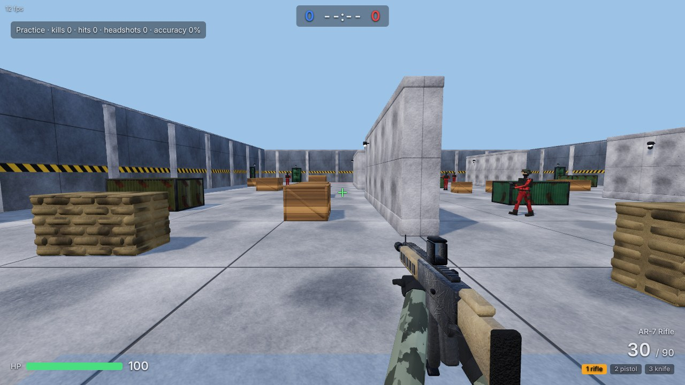
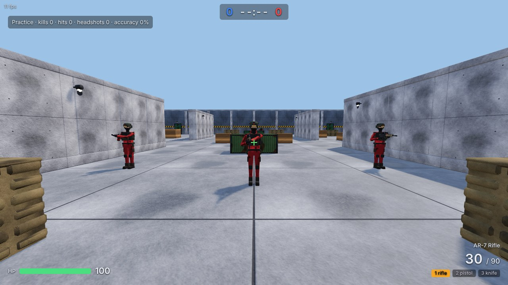
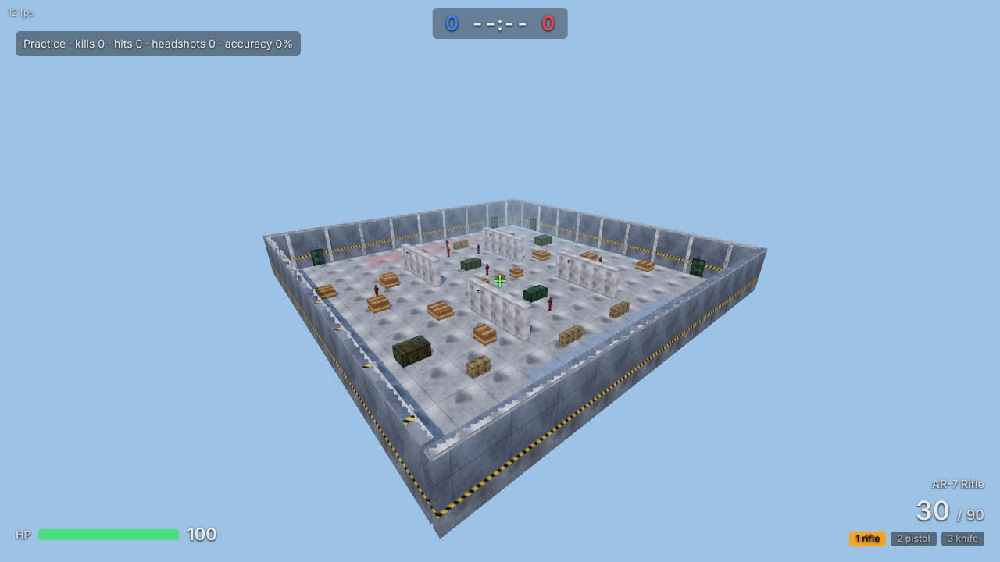

# Report — realistic low-poly asset overhaul

Branch `feature/realistic-assets` (based on `feature/fps-mvp`). Gameplay, network protocol and server logic are unchanged
(`server/` only gained a CSP `blob:` entry and two assertions in a static-file test). The original MVP report is in
[docs/REPORT_MVP.md](docs/REPORT_MVP.md); model list, budgets and licences are in [ASSETS.md](ASSETS.md).

## What was done

* **Replaced every box-built visual** — soldiers, rifle, pistol, knife, map and props — with generated `.glb` models
  (`client/assets/models/`, 9 files, **7.75 MB**, 256–512 px textures): see ASSETS.md for the table.
* **Pipeline** (`tools/assets/`): one deterministic Blender script per asset (`map_kit.py`, `rifle.py`, `pistol.py`, `knife.py`,
  `character.py`) + shared helpers; `python tools/assets/build_all.py` rebuilds all models and preview renders. Blender 5.2.2 LTS came
  from the PyPI `bpy` wheel (no Blender binary in the sandbox); textures are numpy-procedural, embedded as JPEG.
  No third-party art packs were available (`client/assets/third_party/` does not exist), so nothing external is used.
* **Soldier**: ~4.9k-tri armature-rigged model (helmet, goggles, gaiter, plate carrier, pouches, pads, gloves, boots), two team colours,
  clips `idle, run, crouch, death, hold_rifle/pistol/knife, shoot_rifle/pistol/knife`; weapons are bone-parented low-poly meshes.
  Authored at exactly 1.80 m so the shared hitbox spec is untouched.
* **Weapons**: generic fictional AR-7 rifle (2.1k tris), P-9 pistol (1.1k), combat knife (0.4k) with named moving parts
  (`slide`, `mag`, `bolt`); first-person variants with gloved hands and sleeves; muzzle-flash sprite and ejected brass in first person.
* **Map**: one bevelled prop per collision box generated from `client/shared/map.json` (concrete barriers with lamps, sandbag walls,
  corrugated containers, braced crates, perimeter walls with hazard band, pilasters, doors and lamps, tiled floor) so visuals equal collision.
* **Rendering**: PBR materials, ACES tone mapping, sRGB output, procedural sky → PMREM reflections, hemisphere + sun with 2048² shadow map
  (characters and props), separate first-person pass, shader warm-up at load, `Graphics: High/Low` option, shadow LOD for far soldiers.

## Visual review (rendered, viewed, corrected — max 3 rounds per asset)

Blender (Cycles) previews of every asset are in `docs/previews/` (3 views for weapons/character; close-ups for the map; run / crouch / death
pose renders for the soldier). In-game Chromium screenshots (software GL, Graphics = High) are in `docs/screenshots/`.

| Asset | Rounds | Problems found by looking at the renders → fix |
|-------|-------:|-----------------------------------------------|
| Map | 3 | container corrugated side panels floated off the box; door leaf near-black; door preview pointed at the wrong side; sandbags and crates accepted |
| Rifle | 3 | floating front sight/optic block; segmented magazine → lofted curve; baseplate detached; too dark/scratchy; two-tone polymer added |
| Pistol | 2 | gap between slide and frame; rest accepted |
| Knife | 2 | fist wrapped from above with the forearm through the handle → hand rebuilt from below |
| Soldier | 3 | helmet covered the face (open brim, rear skirt); back-pack and straps stuck out above the 1.45 m body box (e2e caught it); death fell forwards; **finger meshes had no skin weights and hung in the air when posed (seen in the death render)** |

Representative images (all in the repo): `docs/screenshots/fp_rifle.jpg`, `fp_pistol.jpg`, `fp_knife.jpg`, `fp_rifle_muzzle_flash.jpg`,
`enemy_5m_front.jpg`, `enemy_5m_back.jpg`, `enemy_20m_back.jpg`, `tp_rifle_{front,threequarter,side,back}.jpg`, `tp_pistol.jpg`, `tp_knife.jpg`,
`tp_death.jpg`, `map_overview.jpg`, `map_top.jpg`, `map_spawn_view.jpg`.

My honest assessment of the result: a clear step up from boxes — readable, coherent PBR look, working animation and first-person hands — but it
is **stylised low-poly, not truly realistic**: limbs are rigid segments, faces are covered, hands are simplified, textures are procedural noise.

## Tests (actually run)

| Check | Result |
|-------|--------|
| `./scripts/check.sh` (gofmt, vet, `go test -race ./...`, gitleaks tree + history) | **passes**: app, config, game, lobby, netutil, wsserver `ok`; gitleaks 0 findings (also re-run before each commit); `govulncheck` **SKIPPED** (vuln DB blocked by the sandbox, as before) |
| Server unaffected | all pre-existing Go tests pass unchanged; new assertions: `/assets/models/*.glb` and `GLTFLoader.js` are served from the embedded FS |
| Browser e2e (`e2e/smoke, online, xss, assets`), Chromium, **94 checks, 0 failures**, run on `http://localhost:8080` and on the container IP `http://192.0.2.2:8080` (non-secure context) | pass |
| `e2e/assets.mjs` | all 9 `.glb` load with **no console errors/warnings**; budgets: body 4,942 ≤ 5k, rifle 2,148 ≤ 3k, pistol 1,088 ≤ 1.5k, knife 429 ≤ 0.8k, total 7.75 MB ≤ 20 MB; clips present on both teams |
| Hitbox fit (`assets.mjs`) | model scale factor 1.0000; head-bone vertices y 1.5275–1.80 (head box 1.45–1.80), x ≤ 0.129, z ≤ 0.148 (box 0.18); torso/back ≤ 1.45 m, half-width ≤ 0.245 (box 0.30); legs reach y = 0 |
| Head vs body hits on the new model | aiming at the head-bone vertex centroid (y 1.68) from 12 m: 20/20 shots scored **headshots**; aiming at the chest centroid (y 1.25): 20/20 body hits, **0 headshots** (client-side hit code = same maths as the unchanged server hit test) |
| Existing game flows | smoke (pointer lock, WebAudio, weapon keys, reload, movement), online (two browsers, prediction error 1.3 mm, ammo prediction), xss: all pass with the new renderer |

## Performance

* **FPS was NOT measured on real hardware** — the sandbox has no GPU; SwiftShader (software GL) renders ~2 fps with PBR + skinning, so the
  ≥ 60 fps target is **unverified**. Numbers that do transfer (`e2e/perf.mjs`, 8 soldiers on screen, 1280×720):
  Graphics High: **261 draw calls, 198k triangles per frame** (shadow pass + world + first-person pass); Low (no shadows): **177 calls, 114k tris**;
  animating all 8 soldiers costs **~0.26 ms of JS per frame**. That is well inside what an integrated laptop GPU handles, but treat it as an estimate.
* Reduction measures: the whole map is one merged static mesh (10 draw calls, beats instancing), shader warm-up at load, distant soldiers
  (> 32 m) stop casting shadows, `Graphics: Low` option, pixel ratio capped at 1.5. No LOD meshes (soldier is already ≤ 5k tris).

## Known issues

1. Style is stylised, not photo-real (see assessment above); soldier faces are fully covered (no face texture/model).
2. Third-person soldiers do not pitch their weapon with the player's view angle (aim is horizontal); run cycle has some foot sliding;
   `crouch` is authored but unused (there is no crouch gameplay).
3. Outstretched arms and the held rifle extend beyond the 0.6 m body hitbox in depth (hitboxes were deliberately not changed).
4. First-person hands are blocky gloves; grip poses were tuned by eye on renders, not on real weapon references.
5. Soldiers use 19 materials (19 draw calls each, ×2 with shadows): an atlas would cut draw calls ~3–4× if needed on weak GPUs.
6. Gunmetal scratch texture reads slightly "spider-web" at 256 px close-up; sky is a flat colour behind the PMREM environment;
   a faint sawtooth appears on the near wall tops in the high-angle `map_overview` shadow.
7. `docs/reference/` was absent, so the style match to reference images could not be checked.
8. **PR not opened**: the remote still has no `main` branch (empty repository originally) and creating it would be a push to `main`,
   which is forbidden. Push `feature/realistic-assets` is done; open the PR into `main` once `main` exists, using this report as the description.

## Next steps

* Real-GPU playtest: measure FPS (try `Graphics: High` vs `Low`), tune shadow extent/bias, then atlas the soldier materials if needed.
* Aim-pitch (spine/chest rotation) and a crouch mechanic to use the existing clip; foot IK to remove sliding.
* Replace procedural noise with painted/baked detail (or a CC0 pack in `client/assets/third_party/` with licence notes), add normal-mapped face and skin.
* Optional: dropped-weapon pickups using the world models `rifle.glb/pistol.glb/knife.glb` (currently unused at runtime), decals, dust, tracers as meshes.
