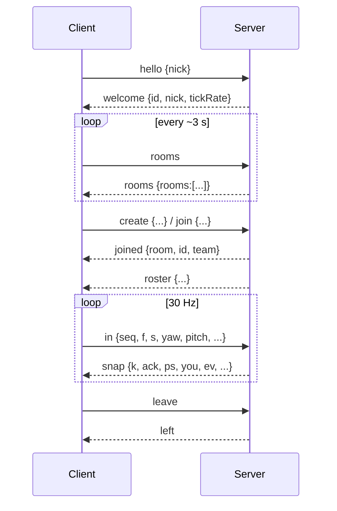

# Strike Zone wire protocol

Transport: one WebSocket per client at `/ws` (same origin as the page: `ws://<host>/ws`).
Frames: **text only**, one JSON object per frame, field `t` = message type. Max frame **4096 bytes**
(larger closes the connection). Server tick = **30 Hz**; every duration below is derived from
`client/shared/spec.json`, which is the single source for hitboxes, speeds, weapons and match rules,
and `client/shared/map.json` (geometry + spawns).

Coordinates: metres, `y` up. Yaw 0 looks toward **-Z**; forward vector = `(-sin yaw·cos pitch, sin pitch, -cos yaw·cos pitch)`;
right = `(cos yaw, 0, -sin yaw)`. Positions are feet positions. Teams are `"A"` (Cobalt) and `"B"` (Ember).

## Connection flow



Before `hello` only `hello` and `ping` are accepted. Protocol violations get an `error` message; after
10 of them (or on malformed JSON / binary frames / rate-limit abuse) the server closes the socket.

## Client → server

| `t` | Fields | Notes |
|-----|--------|-------|
| `hello` | `nick` string | Once. Control/format characters stripped, trimmed, max 16 runes; empty → `PlayerN`. |
| `ping` | `ts` number | Echoed in `pong`. Send every ~4 s (idle timeout is 30 s). |
| `rooms` | – | Request room list. |
| `create` | `name` (1–24 runes), `password` (≤32 bytes, `""` = open), `max` (2–10), `timeLimit` seconds (60–1800), `scoreLimit` (5–100), `map` id from `shared/maps.json` (`""` = default; unknown → `bad_request`), `team` (`"A"`,`"B"`,`"auto"`) | Creator joins immediately. Max 20 rooms server-wide. |
| `join` | `room` id, `password`, `team` (`"A"`,`"B"`,`"auto"`) | |
| `team` | `team` `"A"`/`"B"` | In a room. Respawns you on the new team if alive; refused if that team is full. |
| `leave` | – | Leave the room; the room is deleted when empty. |
| `in` | see below | One per client tick (30/s). Only valid inside a room. |

### `in` (player input)

```json
{"t":"in","seq":1234,"f":1,"s":0,"yaw":1.57,"pitch":-0.1,"jump":false,"walk":false,"fire":true,"reload":false,"weapon":-1,"drop":false,"use":false,"scope":false}
```

| Field | Type / range | Meaning |
|-------|--------------|---------|
| `seq` | uint32, strictly increasing | Acknowledged back in `you.ack`; stale/duplicate → rejected. |
| `f`, `s` | number in [-1, 1] | Forward / strafe axes. Out of range → rejected (not clamped). |
| `yaw`, `pitch` | finite; `|yaw| ≤ 1e4`, `pitch ∈ [-1.6, 1.6]` | View angles (radians). |
| `jump`, `walk`, `fire`, `reload` | bool | Buttons. `walk` = Shift (slow, quiet). `fire` = held state. |
| `weapon` | int, -1 … (weapons-1) | -1 keep, else request switch to slot (0 rifle, 1 pistol, 2 knife, 3 sniper). Switching to a weapon you do not own is ignored. Missing = -1. |
| `scope` | bool | Zoom held. Only has an effect while holding a weapon with `scopeFov > 0` (the sniper) and not reloading; scoped shots use `scopedSpread` instead of `spread`. Missing = false. |
| `drop`, `use` | bool | Edge-detected server side. `drop` throws the current weapon (knife cannot be dropped); `use` picks up the nearest weapon within `pickups.radius` (swaps with the held weapon if that slot is occupied). Missing = false. |

The client **never sends positions**. The server simulates each input with the fixed step
(identical to `client/js/physics.js`, enforced by golden tests). Anti-abuse: at most 1 input/tick is
processed sustained (burst 3, ≤ 2/tick), queue ≤ 8 (oldest dropped), NaN/Inf/range checks, message rate
limit 80/s (burst 120).

## Server → client

| `t` | Fields |
|-----|--------|
| `welcome` | `id` (your player id), `nick` (sanitized), `tickRate` |
| `rooms` | `rooms`: `[{id,name,players,max,locked,timeLimit,scoreLimit,st}]` (`st` = `playing`/`ended`) |
| `joined` | `room` (same shape as above, plus `map`), `id`, `team` |
| `pk` | `list`: `[{id,w,x,y,z,m,r}]` weapons lying on the ground (`w` weapon index, `m`/`r` mag/reserve). Sent after `joined` and whenever the set changes (drop, pick-up, expiry, respawn, match restart). |
| `roster` | `players`: `[{id,nick,team,kills,deaths}]`, `sc`: `[scoreA, scoreB]`. Sent on join/leave/team change/kill/match reset. |
| `left` | – |
| `pong` | `ts` echoed |
| `error` | `code`, `msg` (see below) |
| `snap` | 30 Hz world state (below) |

Error codes: `bad_request`, `not_ready`, `bad_password`, `room_full`, `team_full`, `no_room`, `in_room`,
`not_in_room`, `too_many_rooms`, `server_full`.

### `snap`

```json
{"t":"snap","k":1021,"st":"playing","tl":412,"sc":[7,5],
 "ps":[{"i":1,"x":3.1,"y":0,"z":12.2,"yw":0.4,"pt":0,"a":true,"w":0}],
 "you":{"x":3.1,"y":0,"z":12.2,"vy":0,"g":true,"yw":0.4,"hp":100,"a":true,"w":0,
        "has":[true,true,true,false],"mag":[30,12,0,0],"res":[90,48,0,0],"rl":0,"cd":0,"pf":false,"resp":0,"prot":false,"ack":1234},
 "ev":[{"e":"shot","by":1,"w":0,"from":[3.1,1.62,12.2],"to":[3.0,1.0,-8.0],"hit":"body"}]}
```

* `k` server tick, `st` match state, `win` (`A`/`B`/`draw`, only when `st="ended"`), `tl` seconds left in
  the current phase (match, or intermission), `sc` team scores.
* `ps` all players (including you): feet position, view angles, alive flag, current weapon index.
* `you` private state: authoritative kinematics (`vy`, `g` = on ground) for **reconciliation**, `ack` = last
  processed `seq`; health; per-weapon `has` (weapon owned; false after dropping it) / `mag` / `res`; `rl` ticks until reload completes; `cd` ticks until next
  shot allowed; `pf` fire was held last input (semi-auto edge); `resp` ticks until respawn; `prot` spawn protection.
* `ev` events produced this tick:
  * `shot` `{by,w,from,to,hit}` — `hit` ∈ `""`(nothing in range), `"wall"`, `"body"`, `"head"`. Also sent for knife swings.
  * `hit` `{by,v,w,dmg,head}` — damage dealt (`dmg` includes the headshot multiplier).
  * `kill` `{by,v,w,head}`.

Client behaviour (not enforced by the server): predict own movement and weapon state, on each `snap`
reset to `you`, drop acked inputs and replay the rest; render other players ~100 ms in the past by
interpolating between snapshots.

## Rules summary (values from `spec.json`)

* Health 100. Rifle 30 dmg, pistol 25, knife 40 (range 2.2 m); headshot ×4 (not knife). Head box 0.36×0.35×0.36 m above a 0.6 m-wide body box.
* No friendly fire. Respawn 3 s after death, 1.5 s spawn protection (ends when you fire).
* Match: first team to `scoreLimit` kills or highest score at `timeLimit`; 10 s intermission, then scores reset and everyone respawns.

## HTTP endpoints

| Path | Purpose |
|------|---------|
| `/` and static files | embedded client |
| `/healthz` | `ok` |
| `/ws` | WebSocket |
| `/admin/stats` | JSON `{sessions, rooms}`; only when `ADMIN_TOKEN` is set, `Authorization: Bearer <token>` |
